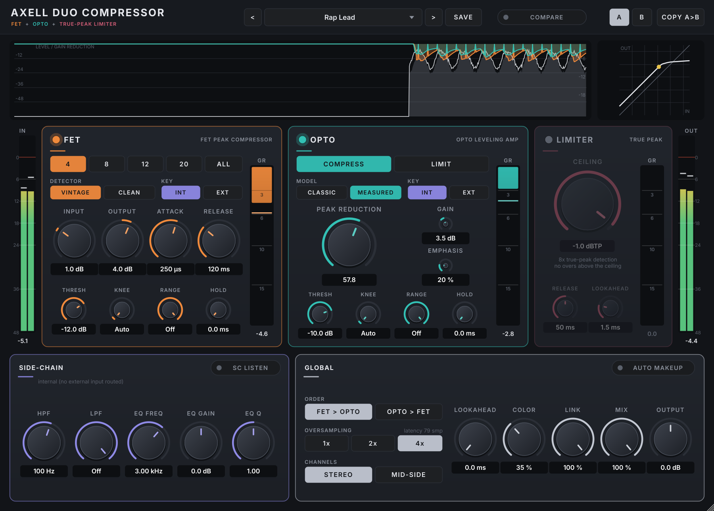

# Axell Duo Compressor (VST3, Linux)

A FET peak compressor, an opto leveling amplifier and a true-peak limiter in one plugin, built for rap and
boom-bap vocals and just as much at home on bass, drums, mix bus and master. Formerly **Duo Vocal Comp**: projects
saved with Duo Vocal Comp 1.0 open in Axell Duo Compressor with every setting and render bit-identically
(checked through a VST3 host, difference exactly 0).

## What it does

**FET** (modelled on the classic 1176-type peak limiter) catches peaks: INPUT drives into the threshold, 20-800 µs
attack, 50-1100 ms program-dependent release, ratios 4 / 8 / 12 / 20 / ALL ("all buttons in").
- **Detector: VINTAGE or CLEAN.** Vintage behaves like the hardware: fast settings add some low-end distortion on bass
  and 808s. Clean keeps the same attack and curve with a ripple-free detector: THD+N -142 dB at 30 and 100 Hz with the
  fastest settings (Vintage: -43 / -46 dB).
- Threshold, knee (Auto = the classic ratio-dependent knee), range (maximum gain reduction) and hold.

**OPTO** (modelled on the LA-2A-type leveling amplifier) levels the performance: a fast grab, a two-stage
program-dependent release, Compress / Limit, HF emphasis, plus threshold, knee, range and hold.
- **Opto Model: MEASURED or CLASSIC.** Measured (the default) is calibrated on recordings of a real LA-2A: the same
  Peak Reduction setting compresses like the hardware's (see [Validation](#validation-against-hardware)). Classic is
  the Duo Vocal Comp 1.x law; projects from 1.x load with it and sound as before.

**LIMITER**: a true-peak brickwall at the end of the chain. Ceiling -24 to 0 dBTP, release, lookahead 0.5-5 ms.
8x true-peak detection. No sample peak ever passes the ceiling, and no inter-sample (true) peak does for content up
to 0.48 fs (21 kHz at 44.1 kHz) - see [the limiter's limits](#the-limiters-limits).

**SIDE-CHAIN**: HPF, LPF and a bell EQ for both detectors (they never change your sound), an external side-chain input
(ducking, keyed compression: KEY = EXT per stage) and SC LISTEN.

**GLOBAL**: stage order, oversampling 1x / 2x / **4x (default: aliasing below -149 dBFS even driven hard)**, Stereo or
Mid/Side, compressor lookahead 0-10 ms (catches transients before they arrive: 23 dB of onset overshoot down to
1.3 dB with 2 ms), Color (analog-style harmonics), stereo link, parallel Mix (sample-aligned), output, auto makeup.

**DISPLAY**: a 5-second history of input and output level with each stage's gain reduction, a transfer curve of the
whole chain at the current settings, and **COMPARE**: hear your unprocessed track at exactly the processed track's
loudness, so you judge what the compression does and not the level change.

Presets for vocals, mix bus, mastering, bass and side-chain ducking; A/B compare; user presets in
`~/.local/share/AxellDuoCompressor/Presets` (Duo Vocal Comp presets are listed too). Latency is reported to the DAW
and changes only after the DAW has been told (no misaligned audio when you switch lookahead, limiter or oversampling).

## Measured quality

| | |
|---|---|
| Silence in | exactly 0 out |
| Transparency (stages off) | -156 dBFS at 1x, -117 dBFS at 2x, -108 dBFS at 4x (error vs the input, < 20 kHz) |
| Aliasing, 15 kHz -3 dBFS, 20:1 +24 dB, Color 100 | -149.5 dBFS at 4x |
| FET bass distortion, Clean detector | THD+N -142 dB (30 / 100 Hz, 20 µs / 50 ms) |
| Limiter, -1 dBTP, +12 dB drums (content ≤ 0.47 fs) | -1.048 dBTP (ideal reconstruction), sample peak -1.05 dBFS |
| Host block sizes 1-4096, every feature on | identical output |
| Real-time safety | no allocation, lock or I/O in the audio path (allocation counter in the test suite) |

All from the automated suites (`tests/`, 2400+ checks at 44.1-192 kHz, mono and stereo), an independent black-box
audit through a VST3 host (`tests/independent/duo_audit.py`), pluginval at strictness 10 and Steinberg's VST3
validator.

## Validation against hardware

Measured against recordings of real hardware published by researchers (details and method:
[docs/research/validation.md](docs/research/validation.md)):

- **Opto vs a Teletronix LA-2A** (SignalTrain dataset, 45 min, three settings): the **Measured** opto law, calibrated
  on part of the recordings and evaluated on the rest at the hardware's own knob settings, follows the hardware's
  gain reduction to **0.6 dB RMS** on music. On the published metrics for this test set it scores STFT error
  **0.449** and loudness error **0.43 dB**; the neural models published for it reach 0.551-0.796 and 0.36-1.31 dB.
  The 1.x law (still available as Classic) missed by 10-17 dB at the same knob numbers.
- **FET vs a 1176LN** (one setting: ALL, 800 µs, 1100 ms; 593 held-out notes): gain trajectory within 1.45 dB RMS
  of the hardware's 3.7 dB of movement. The recorded unit flattens peaks harder at that setting; with a single
  setting available the FET law was left unchanged (see the report).
- **Blind test kit**: ABX and MUSHRA-style trials, hardware vs plugin, loudness-matched
  (`tools/listening/`). Listener results are still to be collected.

## Benchmark against the UADx 1176 and LA-2A

Measured side by side with Universal Audio's UADx emulations of the same two units, in the same host, with the same
analysis ([docs/research/benchmark.md](docs/research/benchmark.md)):

- **Ahead on engineering**: 30-85 dB less aliasing, correct latency reporting, no noise, a distortion-free detector
  option, plus a true-peak limiter, lookahead, Mid/Side and an external side-chain with EQ.
- **On par for the LA-2A**: closer gain tracking on music (0.68 vs 0.89 dB) and loudness (0.36 vs 0.56 dB); UAD is
  closer in spectral match and on fast onsets after short dips.
- **Behind for the 1176**: gain-trajectory error 1.46 dB vs UAD's 1.09 dB at the one setting with public hardware data.

## The limiter's limits
No low-latency detector can predict exactly how a signal reconstructs between samples when it contains energy
right below Nyquist (above 0.48 fs: 21.2-22.05 kHz at 44.1 kHz). With synthetic full-band material (white-noise
snares and hats at full scale up to Nyquist) the measured worst true peak is +0.31 dB over the ceiling at 2x/4x
(the oversampling filters remove most of that band) and +0.61 dB at 1x. Sample peaks are always held. Recorded
audio rarely has much energy that high; if you need a hard guarantee for such material, use 2x or 4x and set the
ceiling 0.3 dB lower. Details: `docs/DECISIONS.md` D21.

## Install (Linux)

    tar xzf AxellDuoCompressor-2.0.0-linux-x86_64.tar.gz
    cd AxellDuoCompressor-2.0.0-linux-x86_64
    ./install.sh

The installer copies `Axell Duo Compressor.vst3` to `~/.vst3` and removes an installed `Duo Vocal Comp.vst3` (same
plugin identity: the DAW would otherwise see two plugins claiming one ID). In REAPER: Options > Preferences >
Plug-ins > VST > Re-scan.

## Build (Bazzite / any Linux, inside a distrobox)

    bash scripts/setup-toolbox.sh      # creates the juce-build distrobox (Ubuntu 24.04) once
    bash scripts/build.sh
    bash scripts/test.sh               # DSP + plugin suites
    bash scripts/install.sh

JUCE 8.0.15 (fetched by CMake). The DSP lives in JUCE-free headers (`Source/Dsp.h`, `Engine.h`, `Oversampling.h`)
and is tested with plain g++.

## Credits
Validation data: SignalTrain LA-2A dataset (Hawley, Colburn, Mimilakis; Zenodo 3824876, CC BY 4.0); 1176LN recordings
of Martínez Ramírez, Benetos and Reiss (Applied Sciences 10(2) 638, 2020; Zenodo 3562442, CC BY 4.0). Product names
are used only to identify the hardware the stages are modelled on and validated against; no code, data, graphics or
impulse responses of any commercial product are used.
