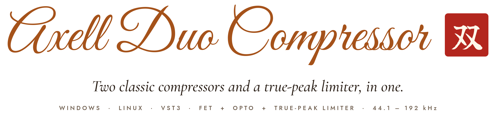
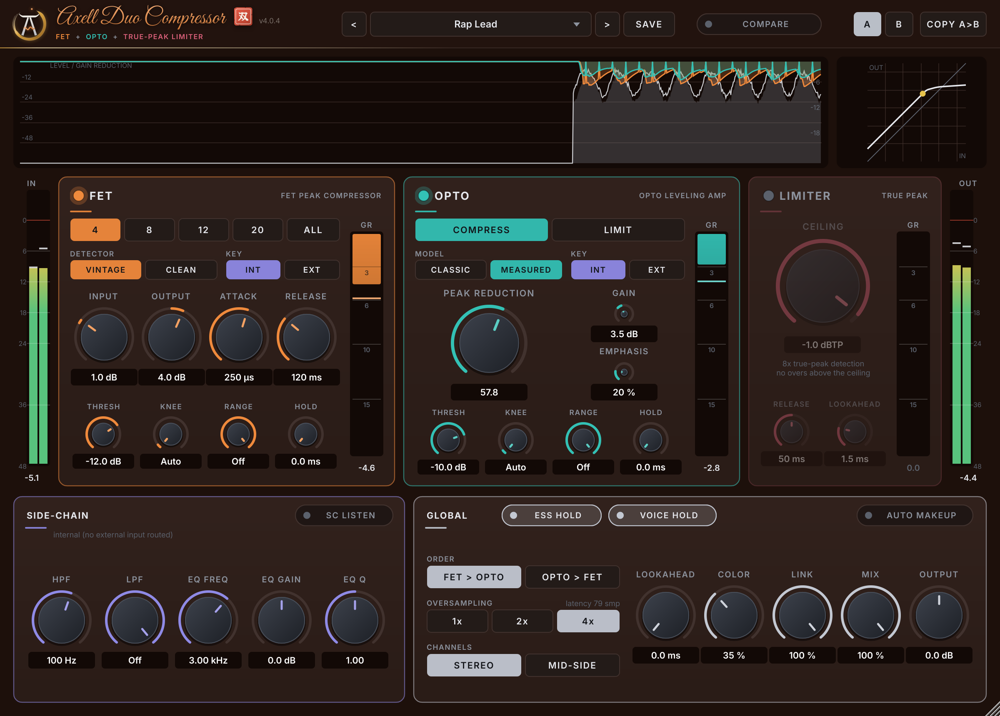
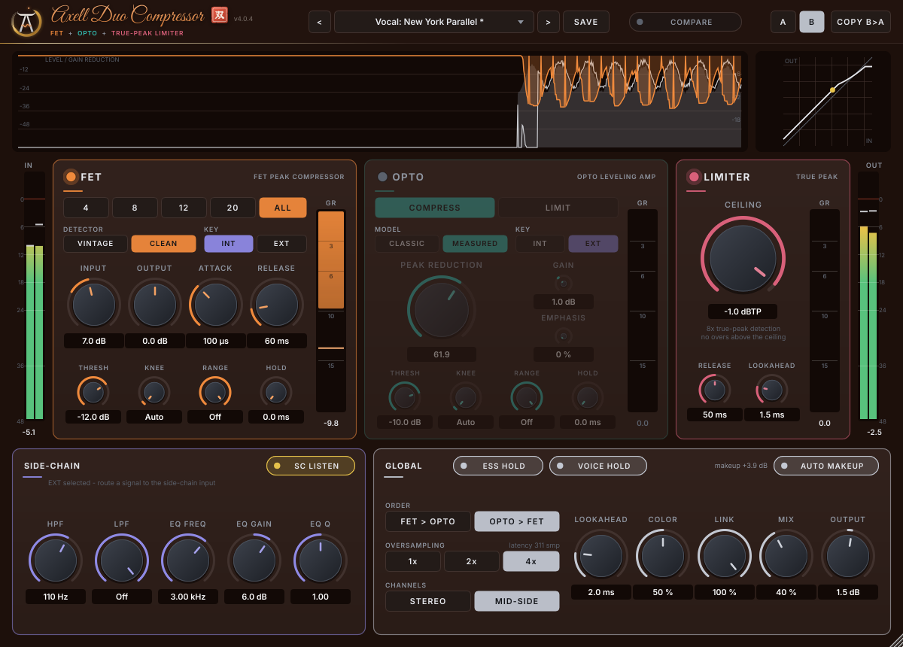
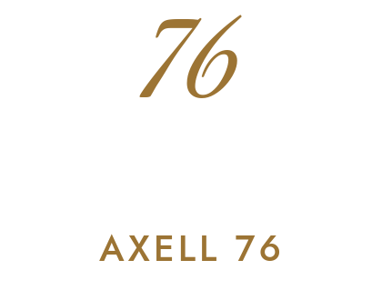

<picture>
  <source media="(prefers-color-scheme: dark)" srcset="docs/img/type/hero-dark.png">
  
</picture>

  
  
  
  
  
  

  

  <b>Two legends and a limiter, in one plugin.</b> 
  A FET peak compressor, an opto leveling amplifier calibrated on recordings of real hardware, and a true-peak limiter - built for rap and boom-bap vocals, and just as much at home on bass, drums, the bus and the master.

  <a href="https://github.com/zmardanian/axell-duo-compressor/releases/latest"><picture>
  <source media="(prefers-color-scheme: dark)" srcset="docs/img/type/dl-windows-dark.png">
  
</picture></a>
  &nbsp;&nbsp;
  <a href="https://github.com/zmardanian/axell-duo-compressor/releases/latest"><picture>
  <source media="(prefers-color-scheme: dark)" srcset="docs/img/type/dl-linux-dark.png">
  
</picture></a>

Free and open source (AGPL-3.0)  ·  Windows 10 / 11 and Linux  ·  any VST3 host - FL Studio, Ableton Live, Cubase, Studio One, Bitwig, REAPER

 

<picture>
  <source media="(prefers-color-scheme: dark)" srcset="docs/img/type/h-why-dark.png">
  
</picture>

- **An opto that follows the hardware** - calibrated on LA-2A recordings, it tracks the real unit's gain reduction to 0.6 dB RMS on music it never saw.
- **ESS HOLD** - compressors lift esses above the vowels; Duo holds the word's gain through each ess: +3.28 -> +0.60 dB on 28 real takes.
- **VOICE HOLD** - the room stays down between your phrases: pauses +23.4 -> +5.9 dB on a real take, the voice's compression unchanged.
- **Clean where it should be** - aliasing -149.5 dBFS at 4x on a brutal test; silence in, exactly silence out.
- **Your old sessions are safe** - projects from Duo Vocal Comp 1.0 render bit-identically.

 

<picture>
  <source media="(prefers-color-scheme: dark)" srcset="docs/img/type/h-does-dark.png">
  
</picture>

A FET peak compressor, an opto leveling amplifier and a true-peak limiter in one plugin, built for rap and
boom-bap vocals and just as much at home on bass, drums, mix bus and master. Formerly **Duo Vocal Comp**: projects
saved with Duo Vocal Comp 1.0 open in Axell Duo Compressor with every setting and render bit-identically
(checked through a VST3 host, difference exactly 0).

**FET** (modelled on the classic 1176-type peak limiter) catches peaks: INPUT drives into the threshold, 20-800 µs
attack, 50-1100 ms program-dependent release, ratios 4 / 8 / 12 / 20 / ALL ("all buttons in").
- **Detector: VINTAGE or CLEAN.** Vintage behaves like the hardware: fast settings add some low-end distortion on bass
  and 808s. Clean keeps the same attack and curve with a ripple-free detector: THD+N -142 dB at 30 and 100 Hz with the
  fastest settings (Vintage: -43 / -46 dB).
- Threshold, knee (Auto = the classic ratio-dependent knee), range (maximum gain reduction) and hold.

**OPTO** (modelled on the LA-2A-type leveling amplifier) levels the performance: a fast grab, a two-stage
program-dependent release, Compress / Limit, HF emphasis, plus threshold, knee, range and hold.
- **Opto Model: MEASURED or CLASSIC.** Measured (the default) is calibrated on recordings of a real LA-2A: the same
  Peak Reduction setting compresses like the hardware's (see [Validation](#validation-against-hardware)). Classic is
  the Duo Vocal Comp 1.x law; projects from 1.x load with it and sound as before.

**LIMITER**: a true-peak brickwall at the end of the chain. Ceiling -24 to 0 dBTP, release, lookahead 0.5-5 ms.
8x true-peak detection. No sample peak ever passes the ceiling, and no inter-sample (true) peak does for content up
to 0.48 fs (21 kHz at 44.1 kHz) - see [the limiter's limits](#the-limiters-limits).

**SIDE-CHAIN**: HPF, LPF and a bell EQ for both detectors (they never change your sound), an external side-chain input
(ducking, keyed compression: KEY = EXT per stage) and SC LISTEN.

**GLOBAL**: stage order, oversampling 1x / 2x / **4x (default: aliasing below -149 dBFS even driven hard)**, Stereo or
Mid/Side, compressor lookahead 0-10 ms (catches transients before they arrive: 23 dB of onset overshoot down to
1.3 dB with 2 ms), Color (analog-style harmonics), stereo link, parallel Mix (sample-aligned), output, auto makeup.

**VOICE HOLD** (3.0): in the pauses of your voice the compressor holds its gain at your voice's level instead of
releasing, so the room, breaths and headphone bleed between phrases are not pulled up (real take: pauses +23.4 dB
against the voice without it, +5.9 dB with it, your voice compressed exactly the same). It uses Axell Gate's voice
detector, adds no latency, and is on for new instances and the vocal presets. Turn it off on drums, beats and buses
(their presets do): the detector is trained on voices and takes drum hits for one.

**ESS HOLD** (4.0): through each ess of your voice the compressor holds the gain reduction of the word it belongs to
instead of releasing, so the S, SH and CH sounds are not pushed above your vowels; after the ess it glides back (10 ms)
to exactly what it would otherwise do. It uses Axell Velvet's sibilance detector (zero latency) and is on for new
instances and the vocal presets; off on beats and buses (the detector fires on hi-hats now and then).

**DISPLAY**: a 5-second history of input and output level with each stage's gain reduction, a transfer curve of the
whole chain at the current settings, and **COMPARE**: hear your unprocessed track at exactly the processed track's
loudness, so you judge what the compression does and not the level change.

Presets for vocals, mix bus, mastering, bass and side-chain ducking; A/B compare; user presets in
`~/.local/share/AxellDuoCompressor/Presets` (Duo Vocal Comp presets are listed too). Latency is reported to the DAW
and changes only after the DAW has been told (no misaligned audio when you switch lookahead, limiter or oversampling).

<table>
<tr><td align="center" width="50%"> At 150 %</td><td align="center" width="50%"> Every stage, every state</td></tr>
</table>

 

<picture>
  <source media="(prefers-color-scheme: dark)" srcset="docs/img/type/h-new-dark.png">
  
</picture>

### What's new in 4.0

- **ESS HOLD**: every compressor lifts the esses above the vowels - between a vowel and its ess it starts to release,
  and the S, SH and CH sounds come up against their own word. ESS HOLD uses the suite's sibilance detector (Axell
  Velvet's, zero latency) to hold the gain reduction at the word's level through each ess, then glides back (10 ms) to
  exactly what 3.0 would do. On 28 of the artist's raw takes through the suite's own vocal chains, the esses' lift over
  their word went **+3.28 -> +0.60 dB**, **+1.42 -> -0.09 dB** and **+1.35 -> +0.03 dB** (Amber, Rap Lead, Boom Bap
  Lead); vowels -0.01..-0.05 dB, pauses unchanged. The de-esser after it has less to do, and fewer esses come back
  later in the chain. On for new instances and the vocal presets; projects from before 4.0 sound exactly as before.

### What was new in 3.0

- **VOICE HOLD**: a compressor releases in every pause, so the room, breaths and headphone bleed between phrases come
  up by as much as the voice is compressed. With VOICE HOLD the suite's voice detector (Axell Gate's) marks the
  pauses and the gain reduction holds at the voice's own level. On a real rap take: pauses **+23.4 -> +5.9 dB** re the
  voice, the voice's compression unchanged, no latency added. On for new instances and the vocal presets; projects
  from before 3.0 load with it off and sound exactly as before.
- **Axell's Dojo look**: the family emblem, a brush-written title with Duo's seal (双, "pair"), an ember ground.

 

<picture>
  <source media="(prefers-color-scheme: dark)" srcset="docs/img/type/h-measured-dark.png">
  
</picture>

### Measured quality

| | |
|---|---|
| Silence in | exactly 0 out |
| Transparency (stages off) | -156 dBFS at 1x, -117 dBFS at 2x, -108 dBFS at 4x (error vs the input, < 20 kHz) |
| Aliasing, 15 kHz -3 dBFS, 20:1 +24 dB, Color 100 | -149.5 dBFS at 4x |
| FET bass distortion, Clean detector | THD+N -142 dB (30 / 100 Hz, 20 µs / 50 ms) |
| Limiter, -1 dBTP, +12 dB drums (content ≤ 0.47 fs) | -1.048 dBTP (ideal reconstruction), sample peak -1.05 dBFS |
| Host block sizes 1-4096, every feature on | identical output |
| Real-time safety | no allocation, lock or I/O in the audio path (allocation counter in the test suite) |
| VOICE HOLD, real take (FET +17 dB, PR 70) | pauses re the voice +23.4 -> +5.9 dB; voice gain reduction 14.1 / 14.2 dB |
| VOICE HOLD, synthetic voice (all rates) | pause lift 18-19 dB lower; voice level within 0.05 dB; block-size invariant; no allocation |

All from the automated suites (`tests/`: 2766 DSP checks at 44.1-192 kHz, mono and stereo, and 131 plugin checks), an independent black-box
audit through a VST3 host (`tests/independent/duo_audit.py`), pluginval at strictness 10 and Steinberg's VST3
validator.

### Validation against hardware

Measured against recordings of real hardware published by researchers (details and method:
[docs/research/validation.md](docs/research/validation.md)):

- **Opto vs a Teletronix LA-2A** (SignalTrain dataset, 45 min, three settings): the **Measured** opto law, calibrated
  on part of the recordings and evaluated on the rest at the hardware's own knob settings, follows the hardware's
  gain reduction to **0.6 dB RMS** on music. On the published metrics for this test set it scores STFT error
  **0.449** and loudness error **0.43 dB**; the neural models published for it reach 0.551-0.796 and 0.36-1.31 dB.
  The 1.x law (still available as Classic) missed by 10-17 dB at the same knob numbers.
- **FET vs a 1176LN** (one setting: ALL, 800 µs, 1100 ms; 593 held-out notes): gain trajectory within 1.45 dB RMS
  of the hardware's 3.7 dB of movement. The recorded unit flattens peaks harder at that setting; with a single
  setting available the FET law was left unchanged (see the report).
- **Blind test kit**: ABX and MUSHRA-style trials, hardware vs plugin, loudness-matched
  (`tools/listening/`). Listener results are still to be collected.

### Benchmark against the UADx 1176 and LA-2A

Measured side by side with Universal Audio's UADx emulations of the same two units, in the same host, with the same
analysis ([docs/research/benchmark.md](docs/research/benchmark.md)):

- **Ahead on engineering**: 30-85 dB less aliasing, correct latency reporting, no noise, a distortion-free detector
  option, plus a true-peak limiter, lookahead, Mid/Side and an external side-chain with EQ.
- **On par for the LA-2A**: closer gain tracking on music (0.68 vs 0.89 dB) and loudness (0.36 vs 0.56 dB); UAD is
  closer in spectral match and on fast onsets after short dips.
- **Behind for the 1176**: gain-trajectory error 1.46 dB vs UAD's 1.09 dB at the one setting with public hardware data.

### The limiter's limits

No low-latency detector can predict exactly how a signal reconstructs between samples when it contains energy
right below Nyquist (above 0.48 fs: 21.2-22.05 kHz at 44.1 kHz). With synthetic full-band material (white-noise
snares and hats at full scale up to Nyquist) the measured worst true peak is +0.31 dB over the ceiling at 2x/4x
(the oversampling filters remove most of that band) and +0.61 dB at 1x. Sample peaks are always held. Recorded
audio rarely has much energy that high; if you need a hard guarantee for such material, use 2x or 4x and set the
ceiling 0.3 dB lower. Details: `docs/DECISIONS.md` D21.

 

<picture>
  <source media="(prefers-color-scheme: dark)" srcset="docs/img/type/h-install-dark.png">
  
</picture>

### Windows

> [!TIP]
> **The whole suite in one go:** the [Axell Signature Suite installer](https://github.com/zmardanian/axell-signature-dojo/releases/latest) puts every Axell plugin and the Dojo on Windows 10 / 11 in one step, each one optional - and the Dojo keeps them up to date. Every VST3 host loads them: FL Studio, Ableton Live, Cubase, Studio One, Bitwig, REAPER.

Windows 10 / 11, 64-bit. Download `AxellDuoCompressor-<version>-windows-x64.tar.gz` from the
[latest release](https://github.com/zmardanian/axell-duo-compressor/releases/latest) (optional: check it against `SHA256SUMS.txt`),
extract it (Windows 11 opens .tar.gz directly; on Windows 10 use 7-Zip or `tar -xzf` in a terminal) and copy the folder
`Axell Duo Compressor.vst3` into `C:\Program Files\Common Files\VST3`. Then rescan plugins in your DAW.
Or install the whole suite in one go with the Axell Signature Suite installer from the
[Axell Signature Dojo releases](https://github.com/zmardanian/axell-signature-dojo/releases/latest) - the Dojo then keeps it up to date.

Your own presets are kept in `%APPDATA%\AxellDuoCompressor\Presets`.

Every Windows build is made by GitHub Actions from this repository, passes the same test suites and pluginval
(strictness 10) as the Linux build, and is checked to sound the same as it (largest difference far below -90 dBFS,
most often bit-identical). The plugin is not code-signed yet; DAWs load it directly.

### Linux

Runs on x86_64 Linux with glibc 2.35 or newer: Ubuntu 22.04+, Debian 12+, Linux Mint 21+, Fedora 36+, Arch, Bazzite.

Download `AxellDuoCompressor-4.0.4-linux-x86_64.tar.gz` from the
[latest release](https://github.com/zmardanian/axell-duo-compressor/releases/latest) (optional: `sha256sum -c
SHA256SUMS.txt`), then:

    tar xzf AxellDuoCompressor-4.0.4-linux-x86_64.tar.gz
    cd AxellDuoCompressor-4.0.4-linux-x86_64
    ./install.sh

Or let the [Axell Signature Dojo](https://github.com/zmardanian/axell-signature-dojo) install and update it.

The installer copies `Axell Duo Compressor.vst3` to `~/.vst3` and removes an installed `Duo Vocal Comp.vst3` (same
plugin identity: the DAW would otherwise see two plugins claiming one ID). In REAPER: Options > Preferences >
Plug-ins > VST > Re-scan.

 

<picture>
  <source media="(prefers-color-scheme: dark)" srcset="docs/img/type/h-history-dark.png">
  
</picture>

| Version | Date | Engineering | Measured |
|---|---|---|---|
| **1.0.0** (Duo Vocal Comp) | 2026 | FET and opto stages in series (order swap), side-chain HPF, Color, Mix, stereo link, HF emphasis, 1x/2x/4x, auto makeup, 22 presets | - |
| **2.0.0** | 2026-10-14 | Renamed Axell Duo Compressor (same plugin identity). True-peak limiter (8x detection), Clean FET detector, threshold / knee / range / hold, side-chain EQ + external key, lookahead, Mid/Side, latency handshake, 4x default, **Measured** opto law calibrated on hardware LA-2A recordings | 1.0 sessions bit-identical; aliasing -149.5 dBFS at 4x; Clean detector THD+N -142 dB (Vintage -43); LA-2A held-out: gain tracking 0.60 dB, STFT 0.449 / loudness 0.43 dB (published neural models 0.551-0.796 / 0.36-1.31) |
| **2.1.0** | 2026-10-15 | Level / gain-reduction history and transfer curve, level-matched COMPARE (BS.1770) | COMPARE within 0.1 dB; benchmark vs UADx 1176 / LA-2A: 30-85 dB less aliasing, LA-2A on par, 1176 behind (1.46 vs 1.09 dB) |
| **3.0.0** | 2026-10-26 | VOICE HOLD with the suite's voice detector (Axell Gate's, in the shared core); Axell's Dojo look | Real take: pauses +23.4 -> +5.9 dB, voice unchanged; 2766 DSP + 131 plugin checks, ASan clean, audit 26/26 (1.0 sessions still bit-identical), pluginval L10, validator 47/47 |
| **4.0.0** | 2026-10-26 | ESS HOLD with the suite's sibilance detector (Axell Velvet's LIVE network, in the shared core): the word's gain held through each ess, a shadow of the 3.x path to return to; tuned on 28 of the artist's takes | Esses over their word: +3.28 -> +0.60 / +1.42 -> -0.09 / +1.35 -> +0.03 dB (three vocal chains), vowels within 0.05 dB; 2948 DSP + 137 plugin checks, ASan clean, audit 30/30 (3.0 sessions bit-identical), pluginval L10, validator 47/47 |
| **4.0.1** | 2026-10-26 | Faster pitch analysis in the shared core (the suite's sibilance detector (ESS HOLD)): eight lags in registers, same summation order | Output byte-identical to 4.0.0; CPU 6.43 -> 5.61 % of one core (-12.7 %) |
| **4.0.2** | 2026-10-27 | The version on the interface (small and quiet after the title) | Audio byte-identical to 4.0.1 |
| **4.0.3** | 2026-11-15 | Faster shared core (detector flatness: one log per frame; inline FFT products; exact true-peak meter shortcut) | Output byte-identical to 4.0.2 (136 renders: 27 presets + 40 random settings); new instance (holds on) 5.58 -> 5.31 % of one core, ESS HOLD detector -9.3 % |
| **4.0.4** | 2026-11-20 | Script wordmark title; the factory preset (Program) is kept with the project; every control named for screen readers | Audio byte-identical to 4.0.3 (136 renders); pluginval 2.0 L10 with the real-time check |

Every design decision with its measurement: [docs/DECISIONS.md](docs/DECISIONS.md); all changes: [CHANGELOG.md](CHANGELOG.md).

 

<picture>
  <source media="(prefers-color-scheme: dark)" srcset="docs/img/type/h-suite-dark.png">
  
</picture>

<table>
<tr><td align="center"><a href="https://github.com/zmardanian/axell-penta-eq"><picture>
  <source media="(prefers-color-scheme: dark)" srcset="docs/img/suite/penta-eq-dark.png">
  
</picture></a> analog-matched EQ</td><td align="center"><a href="https://github.com/zmardanian/axell-duo-compressor"><picture>
  <source media="(prefers-color-scheme: dark)" srcset="docs/img/suite/duo-compressor-dark.png">
  
</picture></a> FET + opto + limiter</td><td align="center"><a href="https://github.com/zmardanian/axell-gate"><picture>
  <source media="(prefers-color-scheme: dark)" srcset="docs/img/suite/gate-dark.png">
  
</picture></a> voice-aware gate</td><td align="center"><a href="https://github.com/zmardanian/axell-dereverb"><picture>
  <source media="(prefers-color-scheme: dark)" srcset="docs/img/suite/dereverb-dark.png">
  
</picture></a> small-room de-reverb</td><td align="center"><a href="https://github.com/zmardanian/axell-velvet"><picture>
  <source media="(prefers-color-scheme: dark)" srcset="docs/img/suite/velvet-dark.png">
  
</picture></a> neural de-esser + warmth</td></tr>
<tr><td align="center"><a href="https://github.com/zmardanian/axell-master"><picture>
  <source media="(prefers-color-scheme: dark)" srcset="docs/img/suite/master-dark.png">
  
</picture></a> mastering limiter</td><td align="center"><a href="https://github.com/zmardanian/axell-space"><picture>
  <source media="(prefers-color-scheme: dark)" srcset="docs/img/suite/space-dark.png">
  
</picture></a> vocal reverb + delay</td><td align="center"><a href="https://github.com/zmardanian/axell-forbidden-seal"><picture>
  <source media="(prefers-color-scheme: dark)" srcset="docs/img/suite/forbidden-seal-dark.png">
  
</picture></a> saturation</td><td align="center"><a href="https://github.com/zmardanian/axell-76"><picture>
  <source media="(prefers-color-scheme: dark)" srcset="docs/img/suite/76-dark.png">
  
</picture></a> 1176 FET compressor</td><td align="center"><a href="https://github.com/zmardanian/axell-signature-dojo"><picture>
  <source media="(prefers-color-scheme: dark)" srcset="docs/img/suite/signature-dojo-dark.png">
  
</picture></a> the suite's home</td></tr>
</table>

Nine plugins and their home, built as one family: they share a core library, so a breakthrough in one becomes a feature of the next - the sibilance network of Velvet guards the esses in Duo, Master, Space and Forbidden Seal; Gate's voice detector holds Duo's and Master's gain through your pauses. The [Axell Signature Dojo](https://github.com/zmardanian/axell-signature-dojo) installs, updates and tunes the whole suite to your voice - on Windows from a single installer.

 

<picture>
  <source media="(prefers-color-scheme: dark)" srcset="docs/img/type/h-build-dark.png">
  
</picture>

    bash scripts/setup-toolbox.sh      # creates the juce-build distrobox (Ubuntu 24.04) once
    bash scripts/build.sh
    bash scripts/test.sh               # DSP + plugin suites
    bash scripts/install.sh

JUCE 8.0.15 (fetched by CMake). The DSP lives in JUCE-free headers (`Source/Dsp.h`, `Engine.h`, `Oversampling.h`)
and is tested with plain g++.

 

<picture>
  <source media="(prefers-color-scheme: dark)" srcset="docs/img/type/h-credits-dark.png">
  
</picture>

**Free forever, kept alive by you.** Axell Duo Compressor costs nothing and never will - no subscriptions, no licence keys. If it has earned a place in your mixes, you can [support the Dojo on Ko-fi](https://ko-fi.com/axellyobag) - one-time or monthly, from €3.

### Credits

VOICE HOLD's voice detector (Axell Gate 2.0's, in axell-core) is trained on CMU ARCTIC and the CSTR VCTK Corpus 0.92
(CC BY 4.0); see THIRD_PARTY_NOTICES.md. Title face: Yuji Syuku (SIL OFL 1.1).
Validation data: SignalTrain LA-2A dataset (Hawley, Colburn, Mimilakis; Zenodo 3824876, CC BY 4.0); 1176LN recordings
of Martínez Ramírez, Benetos and Reiss (Applied Sciences 10(2) 638, 2020; Zenodo 3562442, CC BY 4.0). Product names
are used only to identify the hardware the stages are modelled on and validated against; no code, data, graphics or
impulse responses of any commercial product are used.

### Contact

Axell Yobag - contact@axellsdojo.com (questions, bug reports, feedback). Issues on GitHub are welcome too.

 

From the November 2026 releases on, `SHA256SUMS.txt` is signed with the suite's release key: `minisign -Vm SHA256SUMS.txt -P RWQJLVJSETsP7RRz1rdiugX9w09wtGCtwEc5hHU8k9S+crL/ekfTkQKG`, then `sha256sum -c --ignore-missing SHA256SUMS.txt` (the Axell Signature Dojo checks both itself). How releases are built and signed: [code signing policy](https://www.axellsdojo.com/code-signing/).

<picture><source media="(prefers-color-scheme: dark)" srcset="docs/vst-compatible-dark.svg"></picture>

VST is a registered trademark of Steinberg Media Technologies GmbH. 1176, 1176LN, LA-2A, UADx and Universal Audio are trademarks of their respective owners. The Axell plugins are independent works, not affiliated with or endorsed by them; the names only describe what was measured and compared.
